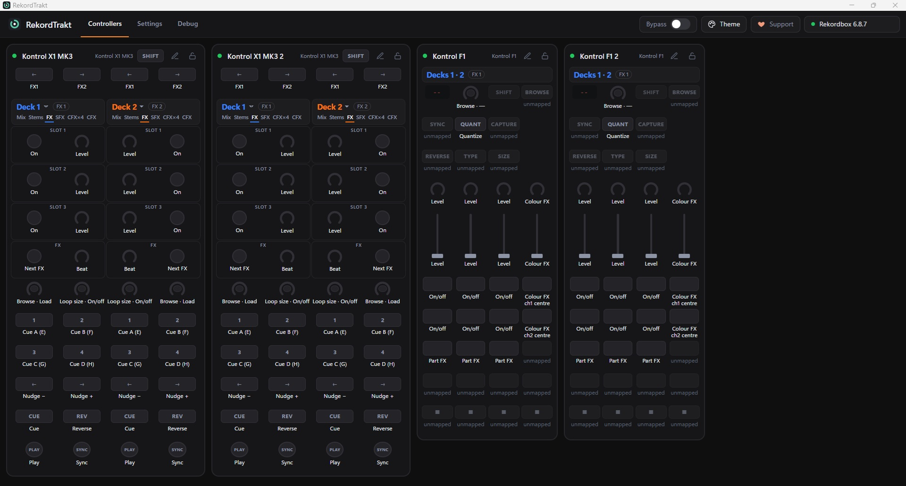
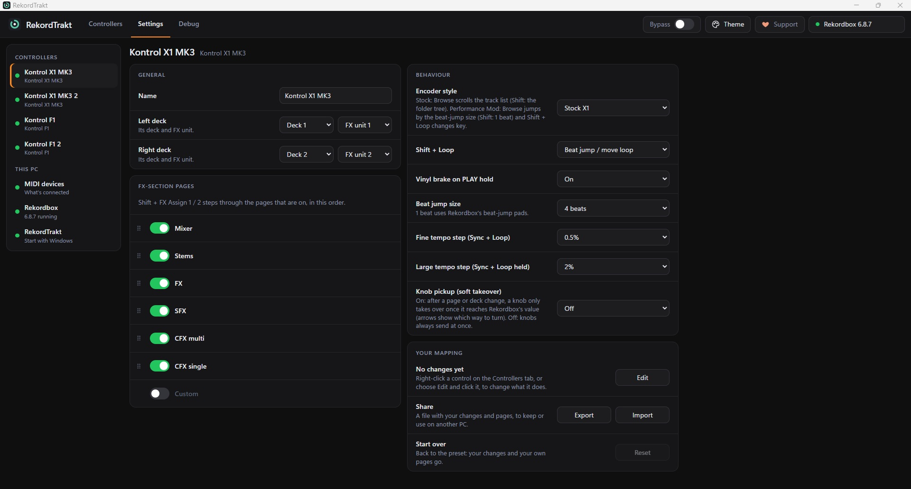
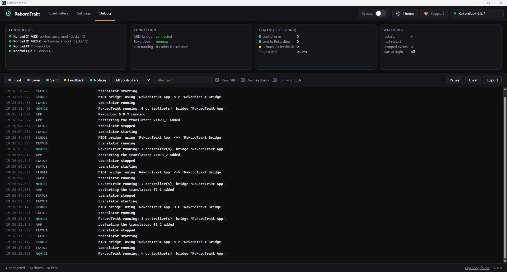

# RekordTrakt

Play Rekordbox with MIDI controllers. RekordTrakt sits between your controller and Rekordbox, and adds what Rekordbox's own MIDI mapping can't do: tap and hold, Shift and held-button layers, pages, several actions on one control, timed sequences, LEDs that follow Rekordbox, and a window that shows what every control does right now. It's built and tested with the Kontrol X1 MK3 and F1, and includes the Kontrol X1 MK1 and MK2 and the Akai AMX and AFX for community testing.



## Features

- **The X1 MK3 Performance Mod, for Rekordbox.** The X1 preset re-creates the community X1MK3 Performance Mod as closely as Rekordbox allows: Sync tap/hold with a tempo layer, eight hot cues, memory cues, vinyl brake, Browser Mode, both of the mod's encoder styles, and FX-section pages (Mixer, Stems, FX, SFX, Colour FX). Each X1 half drives its own deck.
- **The F1 as a stem controller** for two decks: stem levels, mutes, Part FX and Colour FX.
- **A window that mirrors the hardware.** Each controller is drawn as it looks, with every control's current job, its LED, the held layer and the page. Click the on-screen controls to use them like the real ones.
- **Your own mapping.** Right-click any control to change what it does on each layer and page: one Rekordbox function, several at once, a timed sequence, or a value. Add your own FX-section pages, switch preset pages off and drag them into order. Export and import your mapping.
- **No setup files.** Controllers are added in the window. RekordTrakt installs its MIDI mapping into Rekordbox for you (with backups) and builds it for the Rekordbox version you run.
- **Identical controllers stay put.** With Windows MIDI Services, two X1s are told apart by their serial numbers, so they keep their decks when Windows renumbers them after a replug.
- **Other MIDI controllers.** Import a `.midi.xml` controller mapping for a controller RekordTrakt doesn't know yet: its buttons, knobs and LEDs become a controller you can map. Controls the file links to a function work straight away; ones it drives with its own scripts are listed for you to map.
- **New controllers without code.** A controller's faceplate can be included before its MIDI messages are known. Add it, click **MIDI** to learn each control from the hardware, and **TEST** to check them without sending anything to Rekordbox. What you learn takes effect straight away, stays in your settings, and can be shared in a [controller capture](docs/X1-COMMUNITY-CAPTURE.md).

## Requirements

- **Windows 11.** Version 25H2 or later includes Windows MIDI Services, which RekordTrakt uses for its connection to Rekordbox. On earlier versions, the window explains how to use loopMIDI instead.
- **Rekordbox 6 or 7**, with its MIDI mapping available. RekordTrakt detects which one you run and builds its MIDI mapping for it, including Rekordbox 7's own functions (the Bass stem, Drum Swap and more). Both read the same mapping folder, so you can switch between them.
  - Rekordbox 6 needs a Pioneer DJ Hardware Unlock device (a DDJ-XP1, for example) connected, or a paid plan.
  - Rekordbox 7 needs a paid plan: a Hardware Unlock device doesn't unlock its MIDI mapping.
- **Controllers in MIDI mode:**
  - X1 MK3: hold Shift and press Mode. X1 MK2: hold Shift and press both Load buttons. X1 MK1: hold Shift and press Hotcue.
  - F1: hold Shift and press Browse. RekordTrakt's F1 matches the Controller Editor template *Tekken's Kontrol F1 Ultimate Mapping v3.4*; NI's default F1 template isn't verified yet.
  - Akai AMX and AFX: no MIDI mode needed.

  [Controller layouts and MIDI evidence](docs/CONTROLLER-LAYOUTS.md) says how sure each controller's MIDI map is.

## Install

1. Download `RekordTrakt-1.1.0-setup.exe` from [Releases](https://github.com/Morgazmo/RekordTrakt/releases) and run it. It installs for your Windows user only, so it needs no administrator rights. The installer isn't code-signed, so Windows SmartScreen may ask you to confirm (More info › Run anyway).
2. Start RekordTrakt. It opens its window and adds a tray icon.
3. Put your controllers in MIDI mode, then add them in **Settings › MIDI devices**.
4. Install RekordTrakt's MIDI mapping into Rekordbox: the header shows **Rekordbox's mapping file isn't installed**; click it, then **Install**. RekordTrakt closes Rekordbox for a moment (asking first if a deck is playing), installs the mapping with backups, and starts Rekordbox again, each step on your click.

Uninstalling (Settings › Apps) quits RekordTrakt and puts Rekordbox's MIDI mapping files back as they were. Your settings stay in `%LOCALAPPDATA%\RekordTrakt`.

## Using it

- **Controllers** shows each controller and what its controls do now. Click a controller's name to rename it, or a deck number to change the deck. On-screen controls are locked until you click the lock in a controller's header.
- **MIDI Learn and Test:** click **MIDI**, choose an on-screen control and operate the matching hardware control. Controls labelled `MIDI?` still need an address. Click **TEST** to isolate that controller from Rekordbox while you verify its buttons and values on screen; raw and unknown messages remain visible in Debug.
- **Mapping editor:** right-click a control, or click the pencil in a controller's header and then any control.
- **Settings** has each controller's decks, options and FX-section pages, your mapping (edit, export, import, reset), the MIDI devices on this PC, the Rekordbox mapping file, and Start with Windows.
- **Debug** shows everything RekordTrakt receives and sends, live.
- **The header** shows anything that needs attention (click it for the fix), **Bypass** (your controllers send nothing to Rekordbox), **Theme**, **Support** and which Rekordbox is running.





On the X1 MK3 (Performance Mod preset), hold **both FX Assign buttons** on a half for setup: hot cue 1-4 picks the deck, FX buttons 1/2 the FX unit, PLAY the vinyl brake, SYNC the encoder style, Browse the beat-jump size and Loop the large tempo step. **Shift + FX Assign 1 / 2** steps through the FX-section pages, and **Shift + FX button 4** turns Browser Mode on and off.

## What's been tested

| | Status |
|---|---|
| Rekordbox 6.8.7 with a DDJ-XP1 (Hardware Unlock) | Tested on one rig: two X1 MK3s and two F1s in MIDI mode |
| F1 Controller Editor template | Tekken v3.4: inputs verified on both of its pages. NI's default template, and the F1's colours and display, not yet verified |
| Kontrol X1 MK1 (community testing) | MIDI map from NI's manual, cross-checked against a community mapping; needs confirming on hardware. NI doesn't list the MK1 as Windows 11 compatible |
| Kontrol X1 MK2 (community testing) | Faceplate and starter mapping included; its controls are learned on the hardware with MIDI Learn. LEDs and display not yet supported; the touch strip can be learned and mapped by hand |
| Akai AMX (community testing) | Faceplate, starter mapping and a community MIDI map included; needs confirming on hardware, including its LEDs. Its audio interface is outside RekordTrakt |
| Akai AFX (community testing) | Faceplate and starter mapping included; its controls are learned on the hardware with MIDI Learn. LEDs not yet supported |
| Bridge latency (Rekordbox 6.8.7) | Median round trip 18 ms; worst 54 ms under heavy knob and LED traffic; nothing missed |
| Other Rekordbox 6 versions | Unverified on hardware. Functions are checked against 6.8.7; the window reports functions missing from an installed mapping |
| Rekordbox 7 on a paid plan | Unverified live. Its function list was checked against 7.2.19, but MIDI integration has not been tested |
| The X1's beat-jump size of 1 beat (Rekordbox's beat-jump pads) | Not yet tested |
| ARM64 PCs | Not supported by the installer yet |
| HID mode (the X1's screens and colours) | Not supported |

## Building from source

You need Python 3.13 (64-bit, standard library only) on Windows.

```bash
python -m unittest discover -s tests     # simulated controllers: no hardware needed
node --test tests/browser.mjs            # headless Chrome or Edge: window controls and editor
python -m rekordtrakt app                 # run the app (or double-click RekordTrakt.pyw)
```

The bridge helper (`tools/bridge-helper`) needs the .NET 10 SDK; its README explains how to build it. To build the installer you also need Visual Studio Build Tools (C++) and Inno Setup 6:

```bash
python installer/build.py
```

It bundles your Python's runtime with the app, runs the test suite on the bundle, and writes `dist/RekordTrakt-<version>-setup.exe` and its SHA-256.

Controllers are data files in `rekordtrakt/devices/definitions/`; the format is described in `rekordtrakt/devices/defined.py`.

## Licence

RekordTrakt is free software under the [GNU General Public License v3.0](LICENSE). The installer includes the Python runtime, the .NET runtime and the Windows MIDI Services SDK under their own licences (`THIRD-PARTY-NOTICES.txt` in the installed folder).

RekordTrakt is free. If it helps you, you can [support it on Ko-fi](https://ko-fi.com/rekordtrakt).

## Credits

The X1 MK3 preset re-creates the **X1MK3 Community Performance Mod** by Sûlherokhh and contributors (NI community forum).

The Akai AMX's MIDI map was cross-checked against [rootzoll's open-source AMX mapping](https://github.com/rootzoll/mixxx-akai-amx) (MIT licence).

Rekordbox is a trademark of AlphaTheta Corporation. Traktor and Kontrol are trademarks of Native Instruments GmbH. Akai Professional is a trademark of inMusic Brands. RekordTrakt is not affiliated with or endorsed by any of them.
